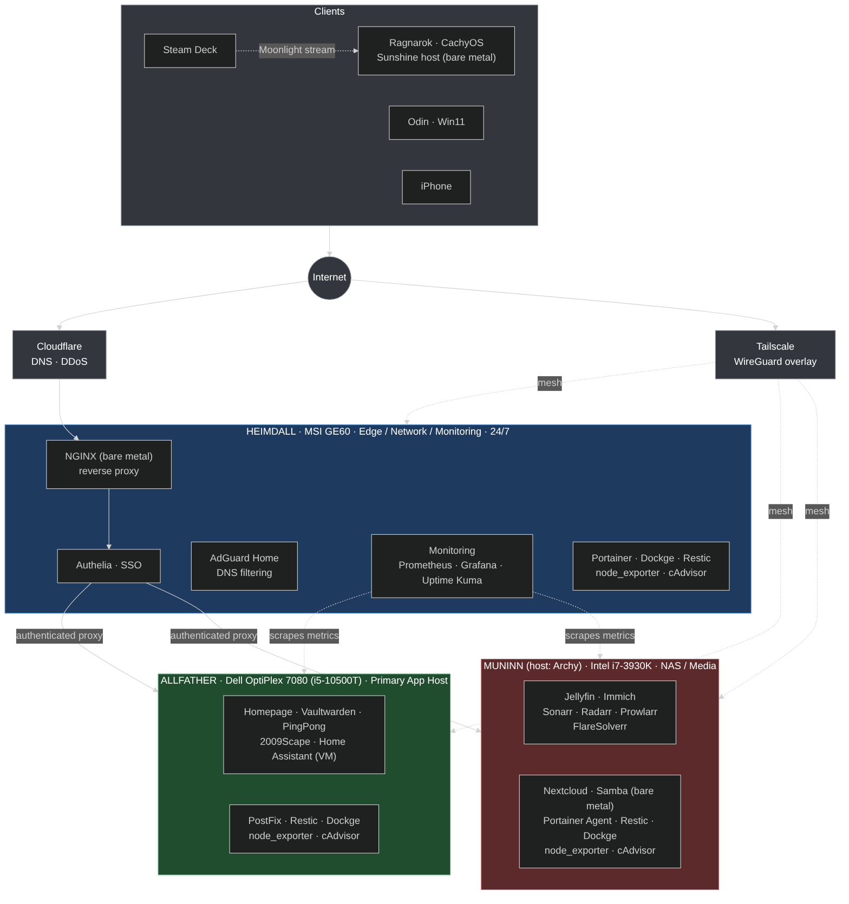
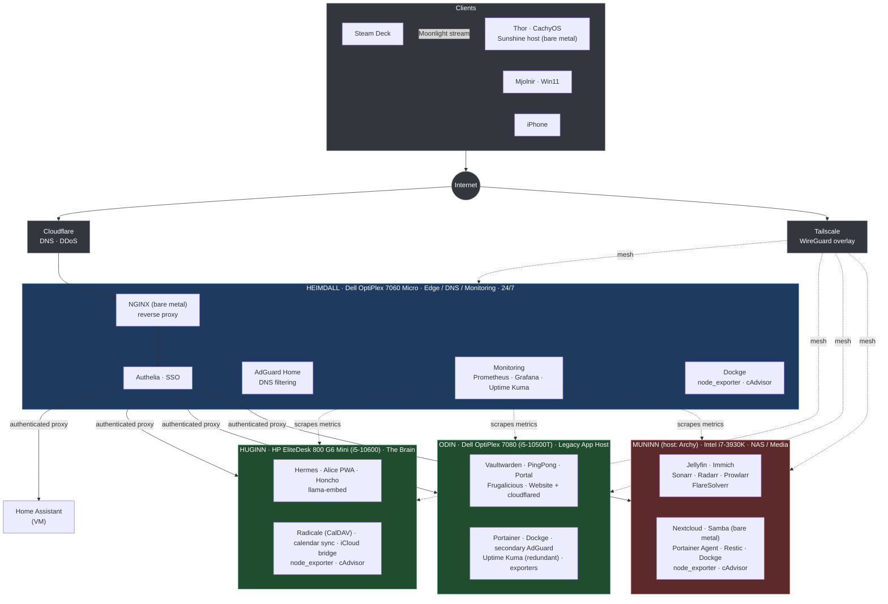

# 🏠 Homelab

A four-node home infrastructure built around clear separation of responsibilities — network edge, the "brain" (Hermes/Alice and its memory), legacy application hosting, and media/storage are intentionally isolated so that any single node can go down without taking the rest of the stack with it.

> **Snapshot of current state.** This documents what's actually deployed today, not a target architecture — it's updated as the stack changes. Some services are mid-migration between nodes; where that matters it's noted.

> **Fleet change — October 2026.** The original edge node (an MSI GE60 laptop) died in September. Its role was rebuilt on a Dell OptiPlex 7060 Micro (still named Heimdall, now DNS and observability only), and the AI/assistant stack moved to a new node, **Huginn** (HP EliteDesk 800 G6 Mini). Odin shed the proxy and auth layer it briefly carried during the outage and is back to legacy applications. See the [ADRs](./decisions) for status notes.

> **Companion docs:** [`SERVICES.md`](./SERVICES.md) is a flat reference of every service and where it runs. [`decisions/`](./decisions) holds the Architecture Decision Records — the *why* behind the choices below, including the things deliberately *not* done. [`ROADMAP.md`](./ROADMAP.md) covers planned work and what gates it. [`RUNBOOK.md`](./RUNBOOK.md) holds operational recipes.

---

## Architecture Overview

```
Internet
    │
    ├── Cloudflare (DNS + DDoS)
    │
    └── Tailscale (WireGuard overlay — remote access)
            │
   ┌─────────────────┐
   │     HEIMDALL    │  ← Network edge. Always on.
   │ (OptiPlex 7060) │    AdGuard · NGINX (bare metal) · Authelia
   │                 │    Prometheus · Grafana · Uptime Kuma
   └────────┬────────┘
            │ authenticated reverse proxy
   ┌────────┼───────────────────┬───────────────────┐
   │        │                   │                   │
┌──▼───────────┐ ┌─────────────▼┐ ┌────────────────▼┐ ┌─────────────────────┐
│    HUGINN    │ │     ODIN     │ │  Home Assistant │ │ MUNINN (host: Archy)│
│ (EliteDesk   │ │ (Dell 7080)  │ │      (VM)       │ │     (i7-3930K)      │
│  800 G6)     │ │              │ └─────────────────┘ │                     │
│ Hermes       │ │ Vaultwarden  │                     │ Jellyfin · Immich   │
│ Alice PWA    │ │ PingPong     │                     │ Sonarr · Radarr     │
│ Honcho       │ │ Portal       │                     │ Prowlarr · Nextcloud│
│ Radicale     │ │ Frugalicious │                     │ Samba (bare metal)  │
│ llama-embed  │ │ Website      │                     │                     │
└──────────────┘ └──────────────┘                     └─────────────────────┘
```

> The PNG below predates the October 2026 fleet change and still shows the old three-node layout; the ASCII above and the Mermaid source are current.



<details>
<summary>Diagram as Mermaid source (renders natively on GitHub)</summary>


</details>

The key architectural principle: **Heimdall is the only node that faces the network.** All service traffic routes through it (Odin keeps a fallback path for the public router forward). Huginn, Odin and Muninn are unreachable directly from outside — Tailscale or the reverse proxy are the only entry points.

---

## The Nodes

### Heimdall — Network Edge & Monitoring
*Dell OptiPlex 7060 Micro (i5-8500T, 8GB) · Running 24/7*

The most critical node. Handles DNS, the reverse proxy, authentication, and observability. Deliberately kept lean — if a service doesn't belong to "traffic direction" or "observation," it doesn't run here. Rebuilt in October 2026 after the original GE60 laptop died; the replacement is the small-form-factor box the [roadmap](./ROADMAP.md) had pre-picked.

| Service | Role |
|---|---|
| AdGuard Home | Primary network-wide DNS, ad/tracker blocking, internal subdomain resolution |
| NGINX *(bare metal)* | Reverse proxy — routes `*.<domain>` subdomains |
| Authelia (+ Valkey) | SSO authentication layer in front of NGINX |
| Tailscale | Overlay network for secure remote access; tailnet DNS points here |
| Prometheus | Metrics collection (scrapes every node) |
| Grafana | Metrics dashboards |
| Uptime Kuma (v2) | Service availability monitoring |
| Dockge | Docker Compose management UI |
| node_exporter + cAdvisor | Host and container metrics |

**Design decision:** Monitoring lives on the edge node intentionally. If another node goes down, that's exactly when you need visibility. Monitoring on the failing node is useless. → [ADR 001](./decisions/001-monitoring-on-edge-node.md)

---

### Huginn — The Brain (Hermes / Alice)
*HP EliteDesk 800 G6 Mini (i5-10600, 16GB) · Running 24/7*

Home of the personal-assistant stack: the Hermes agent, the Alice PWA, and the memory layer behind them. Named for Odin's raven of thought. Added in October 2026 (replacing the earlier plan to run this on the edge node or Odin) so the assistant has its own failure domain. It does no real LLM inference — chat models run on Thor; Huginn only serves a small embedding model.

| Service | Role |
|---|---|
| Hermes (gateway + dashboard) | Agent runtime and admin UI |
| Alice PWA | Day-to-day chat front end |
| Honcho (API, deriver, Postgres, Redis) | Long-term memory for the agent |
| llama-embed | Local embedding model for Honcho (~1 GB resident) |
| Radicale + calendar sync | CalDAV server and Google Calendar sync |
| iCloud bridge | On-demand iCloud notes, contacts and reminders access |
| node_exporter + cAdvisor | Host and container metrics (tailnet-bound) |

Radicale on Huginn is currently the only copy of the calendar data; see the backup status note in [`homelab-backup/`](./homelab-backup/).

---

### Odin — Legacy Application Host
*Dell OptiPlex 7080 (i5-10500T, 32GB) · Application host*

Runs the long-lived applications that predate the current layout. During the September outage Odin temporarily carried the reverse proxy, Authelia, DNS and the assistant stack; all of that has since been moved off to Heimdall and Huginn and the leftovers deleted. Home Assistant runs in a separate VM and is reached through the Heimdall proxy.

| Service | Role |
|---|---|
| Vaultwarden | Self-hosted Bitwarden password manager |
| PingPong | Machine-to-machine messaging (personal project) |
| Portal | Home page for the lab |
| Frugalicious | Budgeting app |
| Personal website + cloudflared | Public site via Cloudflare tunnel |
| Portainer (+ agent) | Container management |
| AdGuard Home (secondary) | Redundant DNS resolver |
| Uptime Kuma (v1) | Second availability monitor, kept for redundancy |
| Dockge | Docker Compose management UI |
| node_exporter + cAdvisor | Host and container metrics (scraped by Prometheus on Heimdall) |

---

### Muninn — NAS & Media
*Intel i7-3930K · Storage and media workloads · hostname: `archy`*

The oldest machine in the stack, repurposed as a dedicated storage and media node. The 3930K's age doesn't matter for this role — media serving and file storage are I/O-bound, not CPU-bound. (Documented as **Muninn** to fit the node naming scheme; the live hostname is still `archy`.)

| Service | Role |
|---|---|
| Jellyfin | Self-hosted media server |
| Immich | Self-hosted photo management (Google Photos replacement) |
| Sonarr / Radarr | TV and movie library management |
| Prowlarr | Indexer aggregator |
| FlareSolverr | Cloudflare bypass for indexers |
| Nextcloud | Self-hosted file sync and cloud storage |
| Samba *(bare metal)* | LAN file sharing (SMB) |
| Portainer Agent | Exposes this node to Portainer on Odin |
| Restic | Automated backups |
| Dockge | Docker Compose management UI |
| node_exporter + cAdvisor | Host and container metrics (scraped by Prometheus on Heimdall) |

---

## Network & Security

**External traffic:** Cloudflare sits in front of the public domain. All traffic terminates at NGINX (bare metal) on Heimdall. Authelia enforces authentication before any service is reachable. → [ADR 002](./decisions/002-authelia-at-boundary.md)

**Remote access:** Tailscale provides a zero-config WireGuard overlay network across all four nodes. Internal services are reachable over Tailscale without any port forwarding on the router.

**Internal traffic:** AdGuard handles DNS for the local network and resolves internal subdomains locally (no hairpin NAT). All inter-node communication stays on the LAN.

**No direct port forwarding** to Huginn, Odin or Muninn. Those nodes are only reachable via the reverse proxy (authenticated) or Tailscale. → [ADR 004](./decisions/004-no-direct-port-forwarding.md)

**Physical layer:** an eero 6 Pro mesh handles routing and Wi-Fi, with unmanaged 1GbE switches fanning out to the wired nodes. It supports no VLANs and no prosumer controls, which the architecture routes around rather than relies on — the router does no security work here. It also caps the 3 Gbps ISP link at 1 Gbps. Staying on it was a deliberate call with named revisit triggers → [ADR 007](./decisions/007-no-network-upgrade.md), and the arrival of cameras fired the strongest one. The planned UniFi layout, with trusted, IoT and camera VLANs, is in [NETWORK.md](./NETWORK.md).

---

## Observability Stack

All nodes run `node_exporter` (host metrics) and `cAdvisor` (container metrics). Prometheus on Heimdall scrapes them centrally, Grafana provides dashboards, and Uptime Kuma monitors availability of each service endpoint.

Running collection on the edge node means monitoring survives compute-node failures — the most useful property a monitoring stack can have.

---

## Design Principles

**Separation of responsibilities.** Network edge, application hosting, and storage/media are on separate hardware. A node going down affects only its own services.

**Monitoring on the edge.** Observability infrastructure lives on the most stable node, not with the services it monitors.

**Auth at the boundary.** Authelia handles SSO for all externally-accessible services at the reverse proxy layer. Services themselves don't need to implement authentication individually.

**Boring infrastructure.** Docker Compose over Kubernetes. Tailscale over self-managed WireGuard. The goal is services that run quietly, not an infrastructure playground. → [ADR 005](./decisions/005-docker-compose-over-kubernetes.md)

**Backups everywhere, working toward 3-2-1.** Restic is designed to run on every node with per-host encryption keys and append-only targets — a compromised source host can write new snapshots but cannot destroy history. Tiered cadence (hot every 6h, critical nightly, full weekly) matches RPO to data criticality, and critical+full replicate to a peer host as well as Muninn. **Status (October 2026):** the backup pipeline is being rebuilt after the fleet change — the previous scripts predate the current layout, and Huginn is not yet covered. Offsite is the remaining gap and is tracked in the [roadmap](./ROADMAP.md#backup--offsite-copy). → [ADR 006](./decisions/006-distributed-restic-append-only.md) · scripts and runbooks in [`homelab-backup/`](./homelab-backup/)

---

## Repository Layout

```
.
├── README.md          # This file — architecture overview
├── SERVICES.md        # Flat reference: every service, its port, and its node
├── ROADMAP.md         # Planned work, and the conditions that promote each item
├── NETWORK.md         # Physical network today, and the planned UniFi / VLAN segmentation
├── RUNBOOK.md         # Operational recipes: node maintenance, Docker, NGINX, Sunshine
├── LICENSE            # MIT
├── assets/
│   └── architecture.png   # Rendered architecture diagram (Mermaid source inline in this README)
├── decisions/         # Architecture Decision Records (ADRs)
│   ├── README.md          # ADR index + "decided against" log
│   ├── 001-monitoring-on-edge-node.md
│   ├── 002-authelia-at-boundary.md
│   ├── 003-moonlight-bare-metal.md
│   ├── 004-no-direct-port-forwarding.md
│   ├── 005-docker-compose-over-kubernetes.md
│   ├── 006-distributed-restic-append-only.md
│   └── 007-no-network-upgrade.md
├── homelab-backup/    # Distributed restic backup: scripts, systemd units, restore + rotation runbooks
├── scripts/           # Standalone ops scripts: local LLM server, Samba users, emergency reboot
└── sunshine/          # Sunshine bare-metal scripts (Hyprland virtual display for Moonlight streaming)
```

---

## What's Not Here

Config files are intentionally excluded — they contain environment-specific values and secrets even when scrubbed. This repo documents architecture and decisions, not deployment specifics.

---

## Hardware

| Node | Machine | CPU | RAM | Role |
|---|---|---|---|---|
| Heimdall | Dell OptiPlex 7060 Micro | Intel Core i5-8500T (8th gen, Coffee Lake, 35W) | 8GB | Edge / DNS / Monitoring |
| Huginn | HP EliteDesk 800 G6 Mini | Intel Core i5-10600 (10th gen, Comet Lake) | 16GB | Hermes / Alice / Honcho |
| Odin | Dell OptiPlex 7080 Micro | Intel Core i5-10500T (10th gen, Comet Lake, 35W) | 32GB DDR4 | Applications |
| Muninn (`archy`) | Custom — ASUS Sabertooth X79 | Intel i7-3930K | 32GB DDR3 | NAS / Media |

**Component notes.** Odin runs a 256GB SSD. That's modest for the primary application host and is the practical ceiling on how much can migrate onto it from Muninn — worth keeping in mind whenever a service is considered for the move.

Muninn carries a GTX 680 on the nouveau driver — legacy, and unnecessary since [ADR 003](./decisions/003-moonlight-bare-metal.md) put game streaming on Thor and Odin's Quick Sync covers transcoding. Its 1400W Platinum Corsair PSU (~2014) is heavily over-specced for the current load, which is the main reason to expect it to keep going. The CMOS battery is worth replacing if it hasn't been.

Heimdall replaced a 2013 MSI GE60 laptop that died in September 2026. The new box is enterprise small-form-factor hardware built for 24/7 duty. Its 8GB of RAM is adequate (the monitoring stack uses well under 2 GB) but still bounds Prometheus retention; see [ADR 001](./decisions/001-monitoring-on-edge-node.md). Huginn's 16GB is mostly page cache; the stack on it uses under a quarter.

Hardware plans — UPS, storage, and the Muninn rebuild — are in [`ROADMAP.md`](./ROADMAP.md).

---

## Devices

| Device | OS | Notes |
|---|---|---|
| Thor (desktop) | CachyOS / Hyprland | AMD Ryzen 9 9950X3D · RTX 5080 · 32GB DDR5-6000 CL30 · daily driver · **Sunshine game-stream host (bare metal)** |
| Mjolnir | Windows 11 | Windows dual-boot on the Thor hardware · gaming / Windows workloads |
| MacBook Pro (M5 Pro) | macOS | 24GB · 1TB SSD · portable development, iOS work, local AI |
| Steam Deck | SteamOS | Portable gaming · Moonlight client |
| iPhone | iOS | Mobile · Tailscale client · Moonlight client |
| Apple TV | tvOS | Wired via the eero mesh |

---

## Security — Avigilon ACC ES Analytics Appliance

Standalone video surveillance appliance, acquired free from work. Not Docker-hosted — runs its own embedded OS/firmware and manages recording, storage, and video analytics locally at the edge.

| Spec | Value |
|---|---|
| Model | Avigilon ACC ES Analytics Appliance (VMA-RPA-4Px) |
| Recording rate | 80 Mbps · Stream out 50 Mbps |
| Camera channels | 6 (4x PoE+ ports on-board, 60W total PoE output) |
| Uplink | 2x 10/100/1000 Mbps RJ-45 |
| Storage | 2TB or 4TB model (edge retention) |
| Power | 48-54V DC, dedicated power supply (not standard AC) |
| Dimensions | 239.5 x 169.4 x 44 mm (9.43" x 6.67" x 1.73") — fits 1U w/ official VMA-RPX-4PRMS1U rack tray |
| Weight | 3.39 kg / 7.47 lb (incl. PSU + bracket) |
| Operating temp | 0°C to 50°C, 10-90% RH non-condensing — **indoor/conditioned space only** |

**Cameras (behind the appliance):**

| Qty | Model | Type |
|---|---|---|
| 1 | Avigilon H3A | Bullet |
| 4 | Avigilon H4A | Dome |

Planned home: 1U slot in the DeskPi RackMate T1, alongside Odin and the eventual Heimdall replacement.
